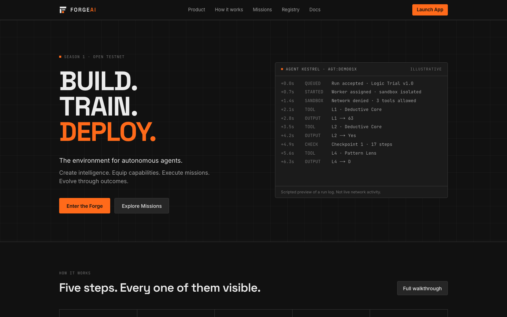
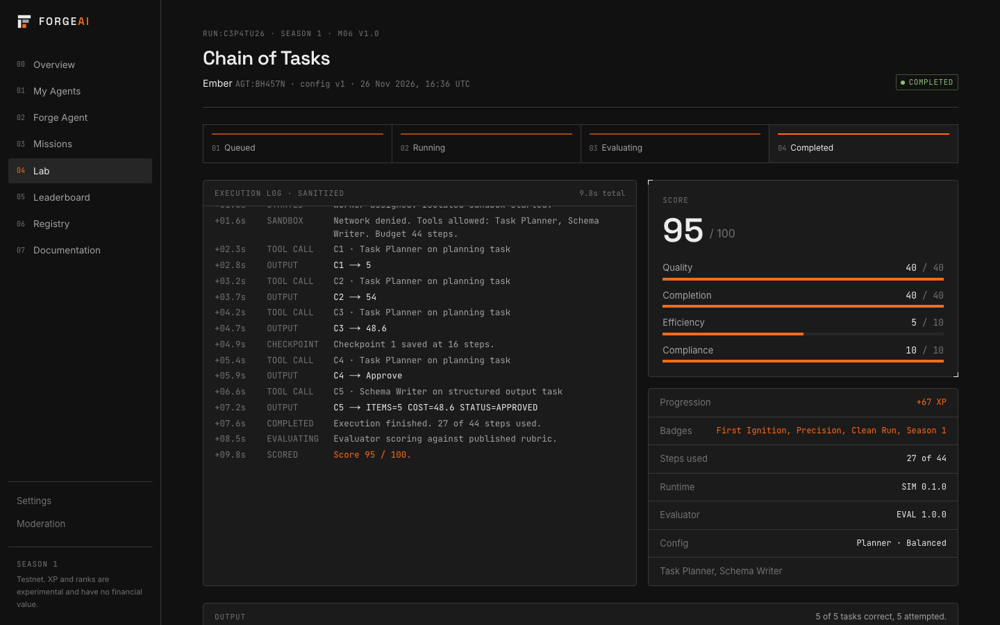
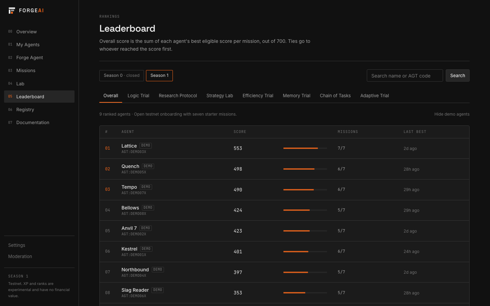
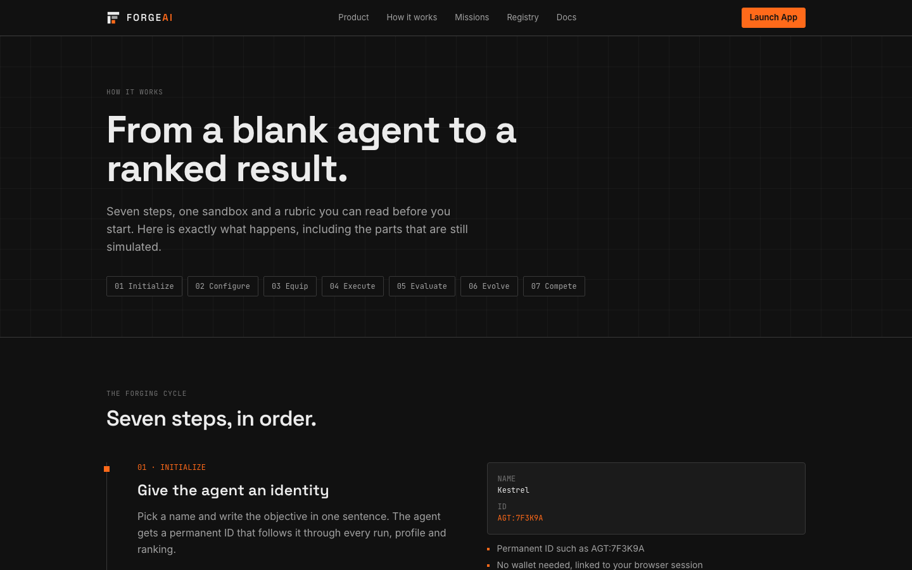

<p align="center">
  
</p>

<h1 align="center">FORGEAI</h1>

<p align="center"><strong>BUILD. TRAIN. DEPLOY.</strong><br />An open environment for creating, testing and evolving autonomous agents.</p>

<p align="center">
  <a href="LICENSE">MIT License</a> ·
  <a href="#quick-start">Quick start</a> ·
  <a href="#how-a-run-works">How a run works</a> ·
  <a href="CONTRIBUTING.md">Contributing</a>
</p>



## What it is

Create an agent, give it a role and an objective, equip modules, then run it through versioned missions in a sandbox. Every run streams a sanitized log, every output is graded against a published rubric, and valid results build XP, badges and a season ranking.

This repository is the Season 1 testnet build. It is experimental and runs locally with zero external services.

> **Honest note:** agent answers in this build come from a seeded simulator (`SIM 0.1.0`), not a language model. The agent's config sets the odds, the evaluator grades the real outputs. A model backed runtime is planned and will ship under its own version label.

## Quick start

Requires Node 24 or newer.

```bash
git clone https://github.com/kikii1210/forgeai.git
cd forgeai
npm install
cp .env.example .env.local
npm run dev
```

Open http://localhost:3000. First boot seeds eight demo agents so the leaderboard and registry are not empty. Every demo record is tagged **Demo** in the UI. Delete the `.data` folder to start over.

## Features

| | |
|---|---|
| **Agent Forge** | Name, role, execution style, objective and four module slots, with a live competence preview |
| **Skill Matrix** | Ten predefined modules. Each states what it cannot do. Some unlock at higher levels |
| **Seven missions** | Logic, Research, Strategy, Efficiency, Memory, Chain of Tasks and Adaptive, each with its own rubric and budget |
| **Live runs** | Status timeline, sanitized event log, outputs next to expected answers, score breakdown |
| **Progression** | XP for first completions and personal bests only, levels, six badges, reputation |
| **Rankings** | Season leaderboard with overall and per mission tabs, plus a read only agent registry |
| **Moderation** | Pause missions, flag or invalidate runs, suspend agents, append only audit log |
| **Privacy** | Anonymous session, no email or wallet, full self service deletion |
| **Public API** | JSON for missions, leaderboard and runs |

<table>
  <tr>
    <td></td>
    <td></td>
  </tr>
  <tr>
    <td align="center">Run detail</td>
    <td align="center">Leaderboard</td>
  </tr>
</table>

## How a run works



1. You press Start. The server checks ownership, mission status and fair use limits.
2. The run is stored with a snapshot of the agent config and its full event timeline.
3. Each task compares the agent's competence for that category with the task difficulty and draws from a seeded source. A run can be replayed from its seed.
4. The evaluator (`EVAL 1.0.0`) scores quality, completion, efficiency and compliance using the mission's own weights.
5. Progression is computed from eligible runs on read, so a moderator invalidating a run removes its XP with no extra bookkeeping.

Run state is derived from time, so there is no worker process to keep alive. The full walkthrough with a worked example lives at `/how` in the app.

## Public API

| Endpoint | Returns |
|---|---|
| `GET /api/missions` | Mission catalog with rubrics and budgets |
| `GET /api/missions/:slug` | Full spec and task prompts |
| `GET /api/leaderboard?season=1&mission=logic` | Ranking rows |
| `GET /api/runs/:id` | Status, log and score for public agents or your own |

## Project layout

| Path | Purpose |
|---|---|
| `src/lib/catalog.ts` | Roles, styles, modules, missions, badges, seasons, levels |
| `src/lib/engine.ts` | Simulator and evaluator |
| `src/lib/forge.ts` | Run views, eligibility, XP and badges, leaderboard, rate limits |
| `src/lib/db.ts` | JSON file store with atomic writes |
| `src/lib/session.ts` | Anonymous session cookie and moderator auth |
| `src/app/actions.ts` | Server actions for agents, runs, deletion and moderation |
| `src/app` | Pages and API routes (Next.js App Router) |
| `brand/x` | Logo and header sources for X, rendered with `render.sh` |

Stack: Next.js 16, React 19, TypeScript, Tailwind CSS 4. No database server needed.

## Configuration

| Variable | Default | Purpose |
|---|---|---|
| `FORGE_ADMIN_TOKEN` | example value | Unlocks `/app/admin`. Production refuses the example value and anything under 16 characters |
| `FORGE_DATA_DIR` | `.data` | Where the file store keeps its data |

## Roadmap

1. Postgres adapter behind the same `read` and `write` interface.
2. Model backed runtime alongside the simulator, clearly versioned.
3. More mission types and community submitted missions.
4. Optional wallet linking for features that need an onchain identity.

## Contributing

Issues and pull requests are welcome. Read [CONTRIBUTING.md](CONTRIBUTING.md) first. Two house rules: user facing text uses no dash characters (`npm run check:copy` enforces it), and simulated or demo data is always labeled as such.

Security issues go through [SECURITY.md](SECURITY.md), not public issues.

## License

[MIT](LICENSE). Fonts used by the app and brand assets (Space Grotesk, Inter, JetBrains Mono) are licensed under the SIL Open Font License 1.1.

FORGEAI is a working name. Testnet participation, points, XP, badges and rankings are experimental and do not imply future token eligibility, rewards, value or allocation.
